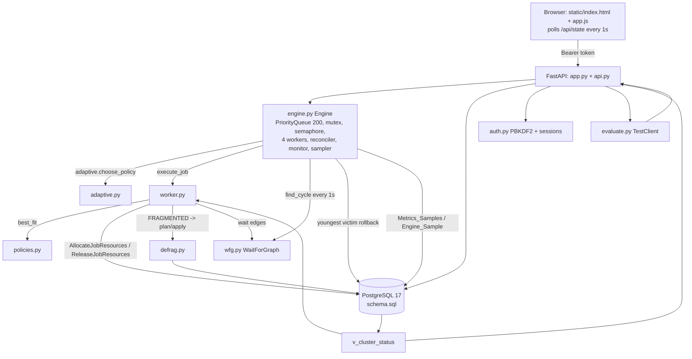

# TransactAlloc — PBL Preparation Report

> How to read this document: every claim below names the real file, function, table, view, or SQL object it comes from. A **term in bold** is defined the first time it appears. If something is not in the code, this document says so instead of guessing.

---

## 1. Elevator pitch and 2-minute pitch

### 1.1 One-paragraph elevator pitch (30 seconds)

TransactAlloc is a cloud resource manager built by Team ArcReactor (B.Tech OSDBMS-V26-T198). Instead of counting RAM as one number, it stores RAM as a **block map** (`Memory_Blocks` in `schema.sql`) — like a hotel's room chart where every room has an address and a free/occupied state. That one design choice turns **external fragmentation** (free memory shattered into unusable pieces) into a plain SQL query in the view `v_cluster_status`, and it lets the system compact blocks and record every move in `Defrag_Events` / `Defrag_Moves`. Jobs are scheduled by FCFS, Priority, or Round-Robin, switched **adaptively** by `adaptive.choose_policy()` and audited in `Policy_Changes`; placement is best-fit; every allocation and release runs inside a real PostgreSQL transaction (`AllocateJobResources()` / `ReleaseJobResources()`) with `FOR UPDATE` row locks and a `Txn_Log` evidence trail. Deadlocks are handled in two layers: Banker's algorithm refuses unsafe grants in `banker.py` (demo/evaluation only), while the live engine detects cycles in an application-level wait-for graph (`wfg.py`) and rolls back the youngest job. A FastAPI backend and a vanilla-JS dashboard make all of it visible live.

### 1.2 Two-minute pitch script (say this, roughly 230 words)

> **[0:00 — hook]** "Imagine a hotel with 500 GB of rooms across four buildings. A naive manager keeps one number: 'how many rooms are free'. Our project, TransactAlloc, keeps the actual floor plan."
>
> **[0:20 — the core idea]** "In `schema.sql`, `Memory_Blocks` stores every RAM block with a `start_mb`, `size_mb`, and `state`. The rows always partition `[0, total_ram_mb)` with no gap and no overlap. Because of that, the view `v_cluster_status` can compute `frag_index = 1 − largest_free / total_free` directly in SQL. Fragmentation stops being a guess and becomes a column."
>
> **[0:50 — correctness]** "When a job is placed, `AllocateJobResources()` locks the CPU and RAM counter rows `FOR UPDATE`, finds the smallest hole that fits, carves it, and updates everything in one transaction. If capacity exists but no hole fits, it raises `FRAGMENTED` so `worker.py` can compact and retry; if capacity truly does not exist it raises `INSUFFICIENT_RESOURCES`. Every outcome is written to `Txn_Log`."
>
> **[1:20 — OS side]** "Scheduling is FCFS, Priority with aging, or Round-Robin with a 5-second quantum. `adaptive.choose_policy()` picks per dispatch round and writes the reason to `Policy_Changes`. We teach deadlocks twice: `banker.py` avoids them by refusing an unsafe grant, and `wfg.py` detects a real circular wait with a three-colour DFS and rolls back the youngest transaction."
>
> **[1:50 — close]** "FastAPI exposes it all, the dashboard polls `/api/state` every second, and `evaluate.py` reports throughput, wait, turnaround and fragmentation per policy. This is a working system, not a diagram: transactions, locks, rollbacks and audits are committed database rows."

---

## 2. The problem: what it solves and why it matters

| Real-world problem | What a naive manager does | What TransactAlloc does (file / object) |
|---|---|---|
| A cluster has enough total free RAM, but it is split into small pieces, so a large job cannot start. | Sees "free RAM = 40 GB" and either over-commits or rejects wrongly. | `v_cluster_status` computes `holes`, `largest_free_mb` and `frag_index` from `Memory_Blocks`; `AllocateJobResources()` raises `FRAGMENTED` when aggregate capacity exists but no single hole fits (`schema.sql`). |
| Two workers grab the last cores at the same time. | Last writer wins; accounting drifts. | `AllocateJobResources()` takes `SELECT … FOR UPDATE` on `CPU_Resources` and `Memory_Resources`; `tests/test_concurrency.py` fires 64 threads and proves no over-commit. |
| A job holds memory on one cluster while waiting for cores on another; nothing moves. | No idea why it is stuck. | `worker._graph_add_waits()` records waiter → holder edges in `wfg.WaitForGraph`; the engine monitor finds the cycle (`engine._monitor_once()`). |
| An operator asks "why did the scheduler change strategy at 10:05?" | No record. | `engine._set_policy()` inserts a row into `Policy_Changes` and `System_Events`. |
| "Did that allocation really commit?" | Trust the console log. | `Txn_Log` has one row per resource transaction with `outcome` and `reason`. |

**Why it matters:** in an Operating Systems lab these are the textbook ideas — scheduling, placement, fragmentation, deadlocks, producer/consumer — and in a DBMS lab these are the textbook ideas — normalisation, keys, ACID transactions, locking, views and functions. This project makes both sets of ideas observable in one running system instead of two separate assignments.

**Analogy:** the RAM block map is a **hotel floor plan**. `Memory_Blocks` is the list of rooms and their addresses. A guest (job) needs contiguous rooms. Best-fit puts them in the *smallest suitable suite* so big suites remain free. When guests leave, `CoalesceFreeBlocks()` merges adjacent empty rooms. A **deadlock** is two guests each standing in the other's doorway, each refusing to step aside — that is the "traffic jam" the wait-for graph detects.

---

## 3. What makes it unique and interesting

### 3.1 Compared with a naive "RAM counter" manager

| Feature | Naive counter | TransactAlloc |
|---|---|---|
| RAM model | One integer `free_ram_mb` | Rows in `Memory_Blocks` partitioning `[0, total_ram_mb)` (`schema.sql`) |
| Can it tell fragmentation? | No | `v_cluster_status.frag_index = 1 − largest_free_mb / free_mb` |
| Can it place a job in a specific hole? | No | `AllocateJobResources()` picks `ORDER BY size_mb ASC, start_mb ASC … FOR UPDATE` |
| Can it compact? | No | `defrag_plan()` + `apply_defrag()` in `defrag.py`, audited in `Defrag_Moves` |
| Can it explain a stuck job? | No | `wfg.edge_details()` + `System_Events` |
| Does it prove correctness? | Print statements | `Txn_Log`, `ValidateBlockMap()`, `tests/test_concurrency.py` |

### 3.2 Why a block-level model makes fragmentation a SQL query

Because the invariant is stored as data. In `schema.sql`, `Memory_Blocks` has `start_mb`, `size_mb`, `state`, and the constraint `block_no_overlap UNIQUE (machine_id, start_mb) DEFERRABLE INITIALLY DEFERRED`. `ValidateBlockMap()` walks the rows in `start_mb` order and verifies the next row starts exactly where the previous one ended. Given that guarantee, the view `v_cluster_status` only needs a `GROUP BY machine_id` over `state = 'FREE'`:

```sql
SUM(size_mb)  AS free_mb,
COUNT(*)      AS holes,
MAX(size_mb)  AS largest_free_mb
```

and then `frag_index = 1 − largest_free_mb / free_mb` (zero when `free_mb = 0`: a *full* cluster is not a *fragmented* one). That is the whole trick — no simulation, no estimate.

### 3.3 Why two deadlock layers

| Layer | File | What it does | When it is used |
|---|---|---|---|
| **Avoidance** | `banker.py` (`safe_sequence`, `grant_is_safe`) | Before granting, asks "does some order still exist in which every job can finish?" If not, refuse. | Demo (`demo.py --avoidance on`) and pure evaluation (`evaluate.py --pure`). `main.py:cmd_run()` explicitly rejects `--avoidance on`. |
| **Detection** | `wfg.py` + `engine._monitor_once()` | Let the cycle form, find it every second with a three-colour DFS, roll back the youngest job. | The live engine and the dashboard. |

Avoidance is cheaper when every job declares its maximum claim, but it is conservative and needs future knowledge. Detection works when claims are unknown, at the cost of recovery. Keeping both lets the team answer the classic viva question "which would you choose and why?" with a comparison instead of an opinion.

### 3.4 Why the wait-for graph is application-level, not `pg_locks`

`pg_locks` shows database locks. In this project a blocked job is **not** blocked inside PostgreSQL: `AllocateJobResources()` raised `INSUFFICIENT_RESOURCES` or `FRAGMENTED`, `try_allocate()` rolled that transaction back, and the job is parked as `QUEUED` in the application queue — while it may still hold resources on another cluster from an earlier phase (`deadlock._holder()`). No row lock is held during that wait, so only the scheduler can see the dependency. Therefore `wfg.WaitForGraph` is a Python structure guarded by an `RLock`, fed by `worker._graph_add_waits()` and `deadlock.LiveDeadlock._holder()`, and exposed through `/api/state`.

### 3.5 Why the policy switches adaptively

Load is not constant. `adaptive.choose_policy()` is a pure function of `Context(queue_depth, running, queued_jobs, now)`:

| Condition in `adaptive.py` | Chosen policy | Reason |
|---|---|---|
| `queue_depth <= 2` | `fcfs` | tiny queue; reordering adds overhead for nothing |
| ≥ 2 jobs with `priority >= 8` waiting > 30 s | `priority` | rescue starving **low-priority** jobs (remember: 1 = highest, 10 = lowest) |
| `queue_depth >= 6` | `round-robin` | fairness; avoid head-of-line blocking |
| otherwise | `fcfs` | default |

`engine._worker()` calls `_decide_policy()` on every dispatch; `engine._set_policy()` writes a `Policy_Changes` row only when the policy actually moved. Placement (best-fit) is deliberately independent of this scheduling choice.

---

## 4. Tech stack, with "why this choice"

| Layer | Choice (evidence) | Why this choice |
|---|---|---|
| Database | PostgreSQL 17 (`docker-compose.yml` image `postgres:17`, `docs/SCHEMA.md`) | Gives real transactions, `CHECK` constraints, foreign keys, `FOR UPDATE`, stored functions, views and deferrable constraints — all the DBMS syllabus items in one engine. `INET` type for `Machines.ip_address` is a bonus. |
| DB driver | `psycopg[binary]==3.2.10` (`requirements.txt`), used in `db.py` | Native psycopg 3 supports `conn.transaction()` and autocommit mode, which the project needs so a raised exception is a genuine `ROLLBACK` (see `worker.py` docstring). |
| Backend | FastAPI `0.115.6` + uvicorn `0.34.0` (`requirements.txt`, `app.py`) | Small ASGI framework, automatic JSON validation with Pydantic models in `api.py`, and `TestClient` so `evaluate.py` can drive the real app in-process without a network port. |
| Frontend | Vanilla HTML/CSS/JS in `static/` (`index.html`, `styles.css`, `app.js`) | No build step, no framework to learn; the dashboard is a polling client over `/api/*`. SVG charts are drawn by string/DOM code in `app.js`. |
| Auth | PBKDF2-HMAC-SHA256, 120 000 iterations (`auth.py`: `ALGO`, `ITERATIONS`) + in-memory bearer sessions | Demonstrates password hashing with a salt and constant-time comparison (`hmac.compare_digest`), plus role-based scoping (`auth.require_admin`, `api._scoped_username`). |
| Async/work | `threading`, `PriorityQueue`, `Semaphore`, `Event` in `engine.py` and `scheduler.py` | Directly models the OS producer/consumer and worker-pool topics. Threads share one database but use separate connections. |
| Tests | pytest `8.3.4` (`requirements.txt`); CI file `.github/workflows/tests.yml` | Separates database-free tests (run in GitHub Actions) from PostgreSQL-dependent tests (run locally after `main.py init`). |
| Deployment | `Dockerfile`, `docker-compose.yml` | Reproducible environment; Compose waits for a `pg_isready` healthcheck before starting the app. |

---

## 5. Main modules: every file in plain words

| File | What it does in plain words | Talks to |
|---|---|---|
| `schema.sql` | Creates the 15 tables, the view, 7 indexes, 6 functions and 1 trigger. Defines the ACID allocation core. | `db.py` applies it; every DB module uses its objects. |
| `seed.sql` | Creates 3 users, 4 clusters (500 GB total) and one free block per cluster. | `main.py init`, `db.py` |
| `db.py` | Builds connections from environment variables; helpers `connect`, `create_database`, `run_sql_file`, `reset_all`, `reset_with_job_seq`. | all DB-touching modules |
| `engine.py` | The engine: bounded queue (200), 4 worker threads, adaptive policy decision, reconciler, deadlock monitor, metrics sampler. | `worker.py`, `adaptive.py`, `scheduler.py`, `wfg.py`, `deadlock.py`, `db.py` |
| `worker.py` | One job's life: pick cluster → allocate → simulate in heartbeats → release/finish. Handles FRAGMENTED retry and wait-for edges. | `policies.py`, `defrag.py`, `db.py`, `wfg` (installed by engine) |
| `defrag.py` | Reads `v_cluster_status` / `Memory_Blocks`, plans compaction, applies it with audit rows. | `schema.sql` functions, `worker.py`, `api.py` |
| `frag.py` | 26-line compatibility alias exporting the same names from `defrag.py`. | `defrag.py` |
| `policies.py` | FCFS, Priority (with aging), Round-Robin slices, best-fit, first-fit, plus `_self_check()`. | `worker.py`, `engine.py`, `evaluate.py`, `main.py` |
| `adaptive.py` | Pure rule `choose_policy(Context)` returning `(policy, reason)`. | `engine.py` |
| `wfg.py` | Wait-for graph: add/replace/clear edges, three-colour DFS cycle detection, `youngest()` victim selection. | `worker.py`, `engine.py`, `deadlock.py`, `api.py` |
| `banker.py` | Banker's algorithm: `safe_sequence`, `is_safe`, `grant_is_safe`, with a worked self-check. | `demo.py`, `evaluate.py`, `test_deadlock.py` |
| `scheduler.py` | Legacy console producer/consumer (`JobScheduler`) and `load_queued()` helper. | `main.py`, `worker.py`, `engine.py` |
| `deadlock.py` | Real two-phase hold-and-wait sessions: two jobs, two clusters, operator-triggered resolution. | `engine.py`, `wfg.py`, `db.py` |
| `live_deadlock.py` | 10-line alias of `deadlock.LiveDeadlock`; no logic of its own. | `deadlock.py` |
| `api.py` | All `/api/*` routes; JSON payload building, quota checks, engine control, defrag, deadlock endpoints. | `auth.py`, `db.py`, `engine.py`, `defrag.py`, `wfg.py` |
| `app.py` | ASGI app object, router mount, `/healthz` and `/health`, static file mount, lifespan that calls `auth.ensure_passwords()`. | `api.py`, `auth.py`, `static/` |
| `main.py` | CLI: `init`, `reset`, `submit`, `batch`, `list`, `stats`, `dashboard`, `run`, `serve`. | `db.py`, `scheduler.py`, `dashboard.py`, `api.py` |
| `auth.py` | Password hashing/verification, in-memory sessions, `viewer()`, `require_admin()`. | `db.py`, `api.py`, `app.py` |
| `dashboard.py` | Console renderer: ASCII/Unicode bars of CPU/RAM and active jobs from `v_cluster_status`. | `main.py` |
| `evaluate.py` | Live policy benchmark through `TestClient` + database-free pure simulation with Banker comparison. | `app.py`, `banker.py`, `policies.py` |
| `demo.py` | Act 1 batch run + Act 2 the report's 121/122 deadlock, detection or avoidance. | `main.py`, `banker.py`, `wfg.py`, `dashboard.py`, `db.py` |
| `smoke_check.py` | HTTP smoke check of login, scoping and live deadlock against a running server. | HTTP `/api/*` |
| `test_deadlock.py` (root) | Proves both deadlock layers against the real database; also runnable as a script. | `demo.py`, `banker.py`, `wfg.py`, `db.py` |
| `test_defrag.py` (root) | Proves compaction merges holes and `Defrag_Moves` records the exact old→new address. | `defrag.py`, `db.py` |
| `conftest.py` | Provides the `conn` fixture (autocommit connection) for the two root test files. | `db.py` |
| `tests/test_db.py` | Allocation/carve/coalesce, FRAGMENTED vs INSUFFICIENT, defrag, deadlock scenario. | `demo.py`, `defrag.py`, `db.py` |
| `tests/test_frag.py` | Block-map invariant, carve/coalesce, defrag compaction on cluster 1. | `defrag.py`, `db.py` |
| `tests/test_concurrency.py` | 64 threads race `AllocateJobResources()` on cluster 4; no over-commit. | `db.py` |
| `tests/test_api_e2e.py` | Whole app in-process: state shape, submit/run/stats, policy switch, defrag, deadlock-demo, stop/resume. | `app.py` |
| `tests/test_engine.py` | Mocked engine monitor: cycle → youngest victim → requeue; acyclic chain untouched. | `engine.py`, `wfg.py` |
| `tests/test_pure.py` | Database-free policy/WFG/adaptive/API-serialization tests. | `policies.py`, `wfg.py`, `worker.py`, `api.py`, `adaptive.py` |
| `tests/test_evaluate.py` | Database-free pure evaluation semantics and metric definitions. | `evaluate.py` |
| `tests/test_cli.py` | CLI argument parsing and `cmd_run` wiring with mocks. | `main.py` |
| `tests/test_dashboard_ui.py` | Reads `static/app.js` as text and asserts the deadlock UI is driven by live API state. | `static/app.js` |
| `static/index.html` | Login screen + six dashboard sections (Overview, Account, Clusters, Jobs, Deadlock, Analytics). | `static/app.js`, `/api/*` |
| `static/app.js` | Polls APIs, draws KPIs, bars, memory strips, WFG SVG, timeline, charts, tables; sends actions. | `/api/*` |
| `static/styles.css` | Graphite/teal theme, responsive layout, animations, admin-only visibility classes. | `static/index.html` |
| `Dockerfile` | `python:3.12-slim`, installs requirements, runs `python main.py init` then uvicorn. | `requirements.txt`, `main.py`, `app.py` |
| `docker-compose.yml` | PostgreSQL 17 service with healthcheck + app service waiting on it. | `Dockerfile`, `db.py` env vars |
| `.github/workflows/tests.yml` | CI: compile modules, run only the four database-free test files. | pytest |
| `.env.example`, `.gitignore`, `.dockerignore` | Document environment variables and keep secrets/caches out of the image and git. | `db.py`, Docker |
| `requirements.txt` | Pins the five Python dependencies. | CI, Docker |
| `README.md`, `docs/*.md` | Human documentation: setup, architecture, ER model, schema reference, evaluation results. | — |
| `cloud_resource_manager_report.pdf` | Original report PDF present in the repo. **Not read for this document** (binary); all report references below come from the Python/SQL code that cites "report section 5". | — |

---

## 6. Architecture and workflow pipeline

### 6.1 Full diagram



Simpler ASCII version of the same pipeline:

```
submit → Jobs(QUEUED) → PriorityQueue → worker → best-fit cluster
       → BEGIN → FOR UPDATE counters → best-fit hole → carve → COMMIT → RUNNING
       → heartbeat ticks → ReleaseJobResources + Coalesce → COMPLETED
```

### 6.2 One job's life, step by step

| Step | What happens | Exact code |
|---|---|---|
| 1. Submit | `POST /api/jobs` validates the Pydantic `SubmitJob` model, checks quota with `_check_quota()` (counts `QUEUED`+`RUNNING`), inserts a `Jobs` row, writes a `SUBMIT` event, then calls `_enqueue()`. | `api.py: submit_job`, `_create_job`, `_check_quota` |
| 2. Queue | `Engine.submit()` deduplicates by `_inflight`, computes `policies.effective_priority(job, time.time())`, and puts `(priority, seq, job)` into a `PriorityQueue(maxsize=200)`; then `self.sem.release()`. | `engine.py: Engine.submit` |
| 3. Policy pick | A worker wakes on `sem.acquire(timeout=0.5)`, takes the job, calls `_decide_policy()`. In `auto` mode this loads queued jobs, builds `Context`, and calls `adaptive.choose_policy()`; a real switch is audited. | `engine.py: _worker`, `_decide_policy`, `_set_policy` |
| 4. Cluster pick | `worker.pick_machine()` reads `v_cluster_status` for `ONLINE` clusters and calls `policies.best_fit()` — the machine leaving the smallest *normalised* leftover of cores and RAM. | `worker.py: machine_snapshot`, `pick_machine`; `policies.py: best_fit` |
| 5. Allocate | `try_allocate()` opens `with conn.transaction()` and calls SQL `AllocateJobResources(job, machine, cpus, ram)`. The function locks CPU and RAM rows `FOR UPDATE`, checks aggregate capacity, picks the smallest fitting FREE block `FOR UPDATE`, carves it (remainder becomes a new FREE block), bumps counters, sets job `RUNNING`. Success writes `Txn_Log(ALLOCATE, COMMIT)`. | `worker.py: try_allocate`; `schema.sql: AllocateJobResources` |
| 6. Run | `_simulate()` sleeps in `HEARTBEAT_SEC = 2` ticks, writing a heartbeat line to `Execution_Logs` each tick. Duration is `remaining_sec`, or `min(5, remaining_sec)` under RR. | `worker.py: _simulate`, `policies.QUANTUM_SEC` |
| 7. Release | `_finish()` runs `ReleaseJobResources()`, which frees the blocks, decrements counters, stamps `released_at`, and calls `CoalesceFreeBlocks()`. Then the job is `COMPLETED` (or `QUEUED` with reduced `remaining_sec` if RR preemption). Writes `Txn_Log(RELEASE, COMMIT)`. | `worker.py: _finish`; `schema.sql: ReleaseJobResources`, `CoalesceFreeBlocks` |

### 6.3 Failure paths

| Path | Trigger | What the code does |
|---|---|---|
| `INSUFFICIENT_RESOURCES` | `total − allocated` < request (`schema.sql`) | `RAISE EXCEPTION`; `try_allocate()` catches `RaiseException`, adds wait edges to current holders via `_graph_add_waits()`, logs `Txn_Log(ALLOCATE, ROLLBACK)`. Reconciler will re-admit the job later. |
| `FRAGMENTED` | Aggregate free RAM is enough, but no single FREE block is big enough | `RAISE EXCEPTION 'FRAGMENTED…'`; `try_allocate()` clears WFG edges, writes a `WARN` log and a `DEFRAG` system event, `Txn_Log(ROLLBACK)`. |
| Defrag retry | `try_allocate()` returned False (either failure) | `execute_job()` calls `defrag.cluster_status()` → `defrag_plan()` → `apply_defrag(triggered_by="AUTO", reason="on-demand retry")` in a transaction, then calls `try_allocate()` once more. If it still fails, `_requeue()` sets the job `QUEUED`. (Honest note: the code attempts defrag after *any* failed allocation, not only `FRAGMENTED`, even though the comment calls it the FRAGMENTED path.) |
| No feasible cluster | `pick_machine()` returns `None` | `_requeue()`; the reconciler retries every 1 s when blockers clear. |
| Deadlock detection | `wfg.find_cycle()` returns a cycle and no live two-phase session is active | `engine._resolve_deadlock()`: pick `wfg.youngest()` by `submitted_at`, in one transaction `ReleaseJobResources(victim)` + `UPDATE Jobs SET status='QUEUED'` + `Execution_Logs('rolled back: deadlock victim')`; then `Txn_Log(DEADLOCK_ROLLBACK, COMMIT)`, `System_Events(DEADLOCK, ERROR)`, clear the job from WFG and `_inflight`. |
| Engine stop | `_stop` event set | `_abort()` releases resources and parks the job `QUEUED` with reduced `remaining_sec`; `stop()` joins all threads. `tests/test_api_e2e.py: test_stop_aborts_and_requeues_inflight_jobs` proves it. |

---

## 7. DBMS concepts mapped to exact code

### 7.1 ER model and normalisation

The full Mermaid ER diagram already exists in `docs/ER_DIAGRAM.md`. The key cardinalities, all backed by foreign keys in `schema.sql`:

| Relationship | Cardinality | Code evidence |
|---|---|---|
| `Users → Jobs` | 1:N | `Jobs.user_id INT NOT NULL REFERENCES Users(user_id)` |
| `Machines → CPU_Resources`, `Machines → Memory_Resources` | 1:1 | `UNIQUE` on `cpu_id`/`mem_id` table's `machine_id` column (`CPU_Resources.machine_id INT NOT NULL UNIQUE REFERENCES Machines`) |
| `Machines → Memory_Blocks` | 1:N | `Memory_Blocks.machine_id … REFERENCES Machines ON DELETE CASCADE` |
| `Jobs → Allocations` | 1:N | `Allocations.job_id … REFERENCES Jobs ON DELETE CASCADE` |
| `Allocations → Memory_Blocks` | 1:1 | `Memory_Blocks.alloc_id INT UNIQUE REFERENCES Allocations ON DELETE CASCADE` |
| `Defrag_Events → Defrag_Moves` | 1:N | `Defrag_Moves.event_id … REFERENCES Defrag_Events ON DELETE CASCADE` |

**Normal form:** `schema.sql` line 6 and `docs/SCHEMA.md` state the schema is **3NF** (Third Normal Form: every non-key column depends on the key, the whole key, and nothing but the key).

**Controlled exceptions (documented, not accidental):**
- `CPU_Resources.allocated_cores` and `Memory_Resources.allocated_ram_mb` are derivable from live `Allocations`. They are kept because they are written in the *same transaction* as the detail rows and are the rows `AllocateJobResources()` locks with `FOR UPDATE`. `ValidateBlockMap()` cross-checks the RAM one.
- `Memory_Blocks.job_id` is a convenience copy of `Allocations.job_id`, kept consistent by the allocation functions and nulled by `ON DELETE SET NULL`.

### 7.2 Keys and constraints (real examples from `schema.sql`)

| Constraint type | Example | File location |
|---|---|---|
| Primary key | `user_id SERIAL PRIMARY KEY`, `job_id SERIAL PRIMARY KEY`, `block_id SERIAL PRIMARY KEY` | `Users`, `Jobs`, `Memory_Blocks` |
| Unique key | `username TEXT NOT NULL UNIQUE`, `hostname TEXT NOT NULL UNIQUE`, `Memory_Blocks.alloc_id INT UNIQUE` | `Users`, `Machines`, `Memory_Blocks` |
| Foreign key | `Jobs.user_id REFERENCES Users`, `Allocations.machine_id REFERENCES Machines`, `Defrag_Moves.block_id REFERENCES Memory_Blocks ON DELETE CASCADE` | respective tables |
| CHECK | `CHECK (role IN ('Admin','User'))`, `CHECK (priority BETWEEN 1 AND 10)`, `CHECK (allocated_cores <= total_cores)`, `CHECK (allocated_ram_mb <= total_ram_mb)`, `CHECK (size_mb > 0)`, `CHECK ((state='ALLOCATED') = (alloc_id IS NOT NULL))`, `CHECK (alloc_cpus + alloc_ram_mb > 0)` | throughout `schema.sql` |
| Deferrable constraint | `CONSTRAINT block_no_overlap UNIQUE (machine_id, start_mb) DEFERRABLE INITIALLY DEFERRED` | `Memory_Blocks`; needed because defrag rewrites offsets in place and two blocks may transiently share an offset before `COMMIT` |

### 7.3 ACID, one example each, pointing at `Txn_Log`

| Property | Meaning | Exact example | `Txn_Log` evidence |
|---|---|---|---|
| **Atomicity** | All steps happen or none do. | `worker.try_allocate()` wraps `AllocateJobResources()` in `with conn.transaction()`; a `RAISE EXCEPTION` inside the carve rolls back the whole carve, counter bump and job update. | `INSERT INTO Txn_Log … op='ALLOCATE', outcome='ROLLBACK', reason=<exception text>` (`worker.py`); `tests/test_db.py: test_insufficient_resources_rolls_back_cleanly` checks the counter is unchanged. |
| **Consistency** | Valid state before and after. | `CHECK (allocated_cores <= total_cores)`, `CHECK (allocated_ram_mb <= total_ram_mb)`, the trigger `trg_jobs_default_remaining`, and `ValidateBlockMap()` keep the block map a valid partition. | `Txn_Log` with `outcome='COMMIT'` after a validated allocation; `demo.finish_and_report()` asserts `allocated <= total` on every node. |
| **Isolation** | Concurrent transactions do not see each other's partial work. | `AllocateJobResources()` starts with `SELECT … FOR UPDATE` on both aggregate rows; `ReleaseJobResources()` locks the same rows in the same `CPU → Memory` order. | `tests/test_concurrency.py` runs 64 threads and checks `used_c == winners * cpus`; `Txn_Log.duration_ms` records each transaction's time. |
| **Durability** | Committed rows survive. | Once `COMMIT` succeeds, the rows are in PostgreSQL; `Txn_Log.job_id` is `ON DELETE SET NULL` and `machine_id` has no FK, so the audit outlives the rows it describes. | Rows with `op IN ('ALLOCATE','RELEASE','DEFRAG','DEADLOCK_ROLLBACK','RESET')`. |

**Honest nuance:** in `worker.try_allocate()` and `_finish()` the `Txn_Log` row is inserted *after* the `with conn.transaction()` block on an autocommit connection. It is therefore an evidence record of the outcome, not part of the same atomic unit as the allocation itself.

### 7.4 Transactions and rollback

- The canonical pattern is in `worker.py`: `with db.connect(autocommit=True) as conn:` then `with conn.transaction():`. Autocommit is **opt-in** in `db.connect()`.
- `schema.sql` explains why: on a non-autocommit connection a preceding `SELECT` would silently turn `conn.transaction()` into savepoints, so an exception would unwind a savepoint and not be a real `ROLLBACK`.
- Failure modes in `AllocateJobResources()` are **raised**, never returned as `FALSE`, which is what makes the caller's transaction really roll back.
- `engine._resolve_deadlock()` is a second example: release + status change + log line inside one `with c.transaction()`.

### 7.5 `FOR UPDATE` row locking

In `AllocateJobResources()`:

```sql
SELECT total_cores - allocated_cores FROM CPU_Resources    WHERE machine_id = p_machine_id FOR UPDATE;
SELECT total_ram_mb - allocated_ram_mb FROM Memory_Resources WHERE machine_id = p_machine_id FOR UPDATE;
```

A second transaction calling the function for the same cluster blocks here; at PostgreSQL's default `READ COMMITTED` it re-reads the committed values when the lock clears (comment in `schema.sql`). The chosen hole is also selected `FOR UPDATE`. `ReleaseJobResources()` locks aggregate rows first, in `machine_id` order, and then allocation rows `FOR UPDATE`, so allocate and release cannot form a lock cycle.

### 7.6 Isolation and concurrency — the 64-thread test

`tests/test_concurrency.py: test_no_overcommit_under_contention()` resets the database, starts **64 threads**, each with its own autocommit connection, inserting a job and requesting 4 cores / 8192 MB on cluster 4. Cluster 4 has 48 cores in `seed.sql`, so at most 12 can win on cores. The test asserts: `used_c <= total_c`, `used_r <= total_r`, `used_c == winners * 4`, `ValidateBlockMap(4)` is true, and every loser is a clean `"rollback"`.

> Honest detail: the test's comment says cluster 4 has 131072 MB, but `seed.sql` actually gives it **249856 MB**. The assertion logic still holds because cores are the binding constraint.

### 7.7 Views — `v_cluster_status`

Defined in `schema.sql`: joins `Machines`, `CPU_Resources`, `Memory_Resources`, and a subquery grouping `Memory_Blocks WHERE state='FREE'`. Columns: `machine_id`, `hostname`, `ip_address`, `status`, `total_cores`, `allocated_cores`, `free_cores`, `clock_speed_ghz`, `total_ram_mb`, `allocated_ram_mb`, `free_ram_mb`, `holes`, `largest_free_mb`, `frag_index`. Consumers: `defrag.cluster_status()`, `worker.machine_snapshot()`, `api.state()`, `api.users()` indirectly, `main.cmd_stats()`, `dashboard.render()`, `deadlock.trigger()`.

### 7.8 Stored functions (all in `schema.sql`)

| Function / trigger | Contract |
|---|---|
| `AllocateJobResources(job_id, machine_id, cpus, ram) → alloc_id` | Lock, capacity check, best-fit hole, carve, counters, job status; raises on failure. |
| `ReleaseJobResources(job_id) → bool` | Lock aggregates first, free blocks, decrement counters, `released_at = NOW()`, coalesce. Does **not** change job status. |
| `CoalesceFreeBlocks(machine_id) → void` | Loops until no adjacent FREE pairs remain; the merged span takes the predecessor's `start_mb`. |
| `ValidateBlockMap(machine_id) → bool` | Checks total size, contiguity (no gap/overlap), end offset, and allocated-sum vs aggregate; raises `BLOCK_MAP_INVALID`. |
| `ResetCluster(restart_jobs_at INT DEFAULT NULL) → void` | Clears history and jobs, zeroes counters, inserts one FREE block per cluster, optionally reseeds `jobs_job_id_seq`. Used by CLI, demo and API. |
| `jobs_default_remaining()` + `trg_jobs_default_remaining` | `BEFORE INSERT` trigger: if `remaining_sec = 0`, set it to `duration_sec`. |

### 7.9 Logging and audit tables

| Table | Defined in | What it records | Written by |
|---|---|---|---|
| `Txn_Log` | `schema.sql` | One row per resource transaction: `op`, `outcome` (`COMMIT`/`ROLLBACK`), `reason`, `duration_ms`, `ts` | `worker.py` (`ALLOCATE`, `RELEASE`), `engine.py` (`DEADLOCK_ROLLBACK`), `api.py`/`demo.py` |
| `Policy_Changes` | `schema.sql` | `from_policy`, `to_policy`, `reason` | `engine._set_policy()` when the policy actually changes |
| `Defrag_Events` | `schema.sql` | Before/after `holes`, `largest_free_mb`, `frag_index`, `blocks_moved`, `mb_moved`, `duration_ms`, `status` | `defrag.apply_defrag()` |
| `Defrag_Moves` | `schema.sql` | Each `block_id` with `from_start_mb → to_start_mb`, `size_mb`, `seq` | `defrag.apply_defrag()` |
| `System_Events` | `schema.sql` | Narrative feed: `kind` in `ENGINE`/`POLICY`/`DEADLOCK`/`DEFRAG`/`SUBMIT`/`QUOTA`/`ERROR` | `api.py`, `engine.py`, `worker.py`, `demo.py` |
| `Execution_Logs` | `schema.sql` | Per-job lines (`INFO`/`WARN`/`ERROR`) | `worker.py`, `engine.py`, `demo.py` |
| `Metrics_Samples`, `Engine_Sample` | `schema.sql` | Time series for charts and evaluation | `engine._sample_once()` every 5 s |

### 7.10 Indexes

`schema.sql` creates seven: `idx_jobs_status_time` on `Jobs(status, submitted_at)`; `idx_alloc_active` — a **partial index** on `Allocations(machine_id) WHERE released_at IS NULL` (only live allocations, which is what the allocator and dashboard query); `idx_blocks_lookup` on `Memory_Blocks(machine_id, state, size_mb)`; `idx_events_ts`, `idx_joblogs_ts`, `idx_metrics_ts`, `idx_txn_ts` on `ts DESC` for the recent-event feeds.

---

## 8. OS concepts mapped to exact code

### 8.1 CPU scheduling

| Algorithm | Code | Behaviour |
|---|---|---|
| FCFS (First-Come, First-Served) — non-preemptive | `policies.fcfs()` | `sorted(jobs, key=lambda j: j["submitted_at"])`. Arrival order only; ignores priority. |
| Priority — non-preemptive | `policies.priority()`, `effective_priority()` | Sort by `(effective_priority, submitted_at)`. **Lower number = higher priority** (1 best, 10 worst, `Jobs.priority CHECK BETWEEN 1 AND 10`). |
| Aging | `policies.effective_priority()` | `max(1, priority − int(waited // AGING_STEP_SEC))`, `AGING_STEP_SEC = 10`: a job climbs one level for every 10 s waited, so a low-priority job cannot starve forever. |
| Round-Robin — preemptive (simulated) | `policies.round_robin()`, `QUANTUM_SEC = 5` | Generator yields `(job, slice)`; each slice is `min(5, remaining_sec)`. In `worker._finish()`, an unfinished RR job is set back to `QUEUED` with reduced `remaining_sec`; `engine._reconciler` re-admits it. |

**Adaptive switching:** `engine._worker()` calls `_decide_policy()` for every dispatch. In `auto` mode `adaptive.choose_policy()` uses queue depth, count of old low-priority jobs (`priority >= 8`, waited > 30 s), and a deep-queue threshold of 6. Manual modes (`fcfs`, `priority`, `round-robin`) bypass the rules but are still audited by `_set_policy()`.

> Term **starvation**: a job never gets CPU because higher-priority jobs keep arriving. Aging is the fix.
> Term **head-of-line blocking**: one slow job at the front holds up everyone behind it; RR addresses this.

### 8.2 Placement: best-fit vs first-fit vs worst-fit

- `policies.best_fit()` filters machines that fit, then minimises `((free_cores − req_cpus)/total_cores + (free_ram_mb − req_ram_mb)/total_ram_mb)`. Dividing by each machine's own capacity prevents "1 core" being compared with "1 MB".
- `policies.first_fit()` takes the first machine in `machine_snapshot()` order that fits. `worker.pick_machine()` uses first-fit only when `policy == "first-fit"`, otherwise best-fit.
- `policies._self_check()` asserts the two disagree for its sample nodes: `first_fit(a, nodes) == 1`, `best_fit(a, nodes) == 2`.
- **Worst-fit is not implemented** anywhere in the code. It is only a textbook contrast; do not claim the repo implements it.
- There is a *second*, block-level best-fit inside `AllocateJobResources()`: `ORDER BY size_mb ASC, start_mb ASC LIMIT 1 FOR UPDATE` — the smallest hole that fits, with address as a deterministic tie-breaker.

### 8.3 Memory management: fragmentation and compaction

- **External fragmentation**: total free memory exists but is split into pieces too small to use. Measured by `frag_index = 1 − largest_free_mb / total_free_mb` in `v_cluster_status` (and recomputed in `engine._sample_once()` for `Metrics_Samples`). `0.0` = one contiguous free region; approaching `1.0` = shattered.
- `test_db.py: test_fragmented_is_distinct_from_insufficient()` builds the textbook case: four equal blocks, release the middle one, request `2*block − 16` MB — aggregate free is enough, no hole fits, so SQL raises `FRAGMENTED`.
- **Compaction / defragmentation**: `defrag.defrag_plan()` walks allocated blocks in address order and emits moves toward offset 0; `defrag.apply_defrag()` rewrites `start_mb`, deletes old FREE blocks, inserts one tail FREE block, calls `CoalesceFreeBlocks()` and `ValidateBlockMap()`, and writes before/after numbers into `Defrag_Events`.
- `test_defrag.py` checks exact moves: a block at 12288 MB moves to 4096 MB and is recorded as `(block_id, 12288, 4096, 4096, 1)` in `Defrag_Moves`.

### 8.4 The four deadlock conditions (Coffman conditions)

| Condition | Plain meaning | Where it appears in this repo |
|---|---|---|
| Mutual exclusion | A resource can be held by only one job at a time. | `Memory_Blocks.alloc_id UNIQUE` and one allocation per block; `FOR UPDATE` row locks in `AllocateJobResources()`. |
| Hold and wait | A job keeps what it has while asking for more. | `deadlock.LiveDeadlock._holder()`: phase 1 allocates on one cluster, then after a delay phase 2 requests on the peer cluster without releasing. |
| No preemption | The system cannot forcibly take a resource away. | The worker never steals another job's blocks; recovery is an explicit victim `ReleaseJobResources()` in `engine._resolve_deadlock()` / `deadlock.resolve()`. |
| Circular wait | A chain of jobs each waiting for the next, closing a loop. | `wfg.WaitForGraph.find_cycle()` returns e.g. `[121, 122, 121]`; the three-colour DFS detects the back edge. |

### 8.5 Resource allocation / wait-for graph

An edge `A → B` means "job A is waiting for a resource held by job B". `wfg.WaitForGraph` stores `edges` (waiter → set of holders) and `_details` (resource, cluster, reason, timestamp), all guarded by an `RLock`. `worker._graph_add_waits()` fills edges from `SELECT DISTINCT job_id FROM Allocations WHERE machine_id=%s AND released_at IS NULL`. `engine._monitor_once()` runs `find_cycle()` every second; if a live two-phase session is active it defers to the operator (`live_deadlock.on_cycle()`), otherwise it auto-resolves.

`youngest(cycle, submitted_at)` selects `max(members, key=submitted_at)` — the newest job, which has done the least work. Because submission time is a total order, victim choice cannot itself loop (no livelock).

### 8.6 Banker's algorithm with the repo's worked example

From `banker.py:_self_check()` and `demo.py`:

- Resource vector layout: `[cores_n1, ram_n1, cores_n2, ram_n2]`.
- Total available: `[20, 65536, 20, 65536]` (nodes 1 and 2 in `seed.sql` are 20 cores / 64 GB each).
- Maximum claims: Job 121 = `[12, 0, 0, 32768]`, Job 122 = `[10, 0, 0, 40960]`.

| Step | Request | Naive check | Banker check |
|---|---|---|---|
| 1 | 121 takes 32 GB on node 2 → `[0,0,0,32768]` | Fits | `grant_is_safe` says **yes**. Remaining `[20,65536,20,32768]`; 121 can finish, release, then 122 runs. |
| 2 | 122 takes 10 cores on node 1 → `[10,0,0,0]` | Fits (10 ≤ 20) — **the trap** | `grant_is_safe` says **no**. After granting, node 1 has 10 cores left but 121 needs 12; node 2 has 32 GB left but 122 needs 40 GB. Nobody can finish → unsafe. |
| 3 | Hold 122 back | — | `safe_sequence(...)` returns an order starting with `121`; with 121 completed, 122 runs. |

Contrast case in `banker.py`: `is_safe([1], {1:[3],2:[3]}, {1:[1],2:[1]})` is **False** (one free unit, both need 2 more), but `is_safe([2], …)` is **True** because job 1 can finish and return its unit.

### 8.7 Process/worker-pool and thread concepts

- `engine.Engine` starts `num_workers` (default 4) **daemon threads** named `ta-worker-N`, plus `ta-sampler` (every 5 s), `ta-deadlock` (every 1 s) and `ta-reconciler` (every 1 s).
- The shared queue is a **bounded buffer** (`PriorityQueue(maxsize=200)`). `threading.Lock` (mutex) protects queue mutation and `_inflight`; `threading.Semaphore(0)` counts available jobs; `threading.Event` handles stop and sampler shutdown. This is the classic producer/consumer pattern from `scheduler.py`'s docstring.
- `scheduler.JobScheduler` is the older console version with `maxsize=100` and the same mutex+semaphore pattern; its docstring notes the mutex is released *before* database work so row-level locking is actually exercised.
- `worker.HEARTBEAT_SEC = 2` gives a cancellation point; active workers are counted with `active_count()` guarded by `_active_lock`.
- `engine._resolve_lock` and `deadlock.LiveDeadlock.lock` (an `RLock`) serialise recovery and session state.

---

## 9. Deadlock demo, explained line by line

### 9.1 `demo.py` (detection mode: `py -3 demo.py --skip-batch`)

Act 1 (`demo.act_one()`) submits 20 jobs (`cli.cmd_batch(seed=7)`), runs `cli.cmd_run(policy="best-fit", workers=4, max_rounds=25)`, then prints `dashboard.render()` and `dashboard.job_summary()`. Act 2 (`demo.act_two()`) produces these lines; each is a `log(...)` call right after a real transaction:

| Log line | What it means / code |
|---|---|
| `DEADLOCK DETECTION (Wait-For Graph) TEST` | `dashboard.banner()`; mode chosen by `--avoidance`. |
| `Job#121 acquires 32GB RAM on Node 02 ... GRANTED` | `guarded()` → `request()` → `AllocateJobResources(121, 2, 0, 32768)` committed. |
| `Job#122 acquires 10 Cores on Node 01 ... GRANTED` | Same for `(122, 1, 10, 0)`. Node 1 now has 10 of 20 cores free — the trap. |
| `Job#121 requests 12 Cores on Node 01 (Holds 32GB RAM on Node 02)` | Next request begins. |
| `-> BLOCKED: Node 01 has fewer than 12 free cores, held by [122]` | `request(...)` raised; `graph.add_wait(121, holder)` records `121 → 122`. |
| `Job#122 requests 40GB RAM on Node 02 (Holds 10 Cores on Node 01)` | Mirror request. |
| `-> BLOCKED: Node 02 has less than 40GB free, held by [121]` | `graph.add_wait(122, 121)`; now a cycle exists. |
| `[WFG ENGINE] Circular Wait Detected: (Job#121 -> Job#122 -> Job#121)` | `graph.find_cycle()` returned a closed path (three-colour DFS). |
| `[DBMS ENGINE] Executing Transaction ROLLBACK on Job#122 (youngest in the cycle)` | `wfg.youngest(cycle, {121:1.0, 122:2.0})` picks 122 (`submitted_at` later). |
| `[TRANSACTION] ROLLBACK SUCCESSFUL. Resources released on Node 01.` | `demo.rollback_job()` ran `ReleaseJobResources(122)` + `UPDATE Jobs SET status='QUEUED'` + `Execution_Logs('rolled back: deadlock victim')` inside one transaction. |
| `[SCHEDULER] Job#121 unblocked and allocated. Job#122 re-queued.` | `request(121, NODE1, 12, 0)` now succeeds. |
| `Invariant holds on every node: allocated <= total.` | `finish_and_report()` counted nodes violating the CAP constraint; count was 0. |
| `Deadlock handled by: DETECTION -- the cycle was found and the youngest job rolled back.` | Final summary line. |

With `--avoidance on`, lines 3–4 become `[BANKER] Job#122 requests 10 Cores on Node 01 -> REFUSED, grant would leave the cluster in an UNSAFE state`, then `[BANKER] circular wait prevented before it could form.` and `[SCHEDULER] Job#122 stays QUEUED until Job#121 completes.` — `banker.grant_is_safe()` never let the second grant happen.

### 9.2 `live_deadlock.py` — honest note

`live_deadlock.py` is **only a 10-line alias**: `from deadlock import LiveDeadlock`. It prints nothing and has no output of its own. The live demo is driven by `POST /api/deadlock/trigger` → `deadlock.LiveDeadlock.trigger()` and `POST /api/deadlock/resolve` → `LiveDeadlock.resolve()`. Its "output" appears in three places:

| Place | What appears |
|---|---|
| Dashboard → Deadlock → *Live deadlock timeline* | `state.deadlock.timeline` lines built by `LiveDeadlock._say()`, e.g. `Submitted Job #… as two-phase workloads`, `Job #… acquired … on cluster-…`, `Job #… requests … -> BLOCKED behind […]`, `[WFG] circular wait detected: #… -> #… -> #…`, `[DBMS] youngest transaction in the cycle is Job #…`, `[OPERATOR] resolve requested; rolling back Job #…`, `[DBMS] ROLLBACK committed; held resources released`, `Deadlock resolved; all held resources released`. |
| `Txn_Log` | `ALLOCATE/COMMIT` with reason `phase 1: hold and wait`, `ALLOCATE/ROLLBACK` with the exception text, `DEADLOCK_ROLLBACK/COMMIT` with `live cycle …` (`deadlock.py:_holder()`, `resolve()`). |
| `System_Events` | `DEADLOCK/WARN` "`live circular wait …; Job #… awaiting operator resolution`" and later `DEADLOCK/INFO` "`resolved …; Job #… rolled back and re-queued`". |

Timeline status goes `triggering → awaiting_detection → detected → resolving → resolved` (also `aborted` / `failed`). The resolve button is enabled only when `status === "detected"` (`static/app.js: applyRole()`).

---

## 10. Performance evaluation

### 10.1 What `evaluate.py` measures

Two modes:

**Live mode** (`run_policy()`): resets, starts the engine with one policy, posts a batch, waits via `_wait_drain()` until no jobs are `QUEUED`/`RUNNING`, reads `/api/stats`, stops the engine. It reports:

| Metric | Definition in code |
|---|---|
| `completed` | count of jobs with `status == 'COMPLETED'` |
| `throughput_per_s` | `completed / stats["throughput"]["span_sec"]` (span = `MAX(completed_at) − MIN(completed_at)` from `api.stats()`) |
| `avg_wait_s`, `p95_wait_s` | mean and nearest-rank (`sorted(waits)[int(len*0.95)]`) of `wait_sec` from `/api/state` |
| `avg_turnaround_s` | mean of `turnaround_sec` |
| `peak_frag_index` | max `frag_index` seen across clusters while polling |
| `defrag_runs`, `avg_alloc_ms`, `deadlocks` | from `stats["defrag"]["runs"]`, `Txn_Log` ALLOCATE COMMIT avg, and count of `System_Events.kind == 'DEADLOCK'` |

**Pure mode** (`--pure`, `run_pure_comparison()`): no PostgreSQL. Deterministic two-phase jobs (`[6,0]` then `[0,6]`, claim `[6,6]`, resources `[10,10]`, seed 11). Adds `avg_response`, `avg_wait`, nearest-rank `p95_wait`, `avg_turnaround`, `service_ticks`, `makespan_ticks`, `throughput_per_tick`, `synthetic_deadlocks`, `synthetic_rollbacks`, `unsafe_grants_prevented`. Honest note stated in `evaluate.py` and `docs/EVALUATION.md`: those deadlock/rollback numbers are **synthetic simulation events**, not WFG or database observations.

### 10.2 What `docs/EVALUATION.md` shows

Historical database-backed table (generated 2026-10-16 00:30; 20 jobs per policy, 4 workers, seed 11, best-fit):

| Policy | Done | Jobs/s | Avg wait (s) | P95 wait (s) | Avg turn (s) | Peak frag | Defrags | Alloc txn (ms) | Deadlocks |
|---|---|---|---|---|---|---|---|---|---|
| fcfs | 20 | 0.45 | 18.63 | 40.94 | 28.2 | 0.5 | 0 | 17.95 | 0 |
| priority | 20 | 0.4 | 18.13 | 40.13 | 27.72 | 0.4286 | 0 | 17.65 | 0 |
| round-robin | 20 | 0.38 | 16.77 | 41.4 | 28.79 | 0.5 | 1 | 16.7 | 0 |

### 10.3 Honest conclusion per policy

- **FCFS:** highest throughput (0.45 jobs/s) and simple, predictable ordering; average wait is slightly worse than the others. Good default for the small queues `adaptive.py` prefers.
- **Priority:** lowest p95 wait (40.13 s) and lowest peak fragmentation (0.4286); throughput marginally below FCFS (0.4). Aging (`policies.effective_priority`) protects against starvation at the cost of reordering.
- **Round-Robin:** lowest *average* wait (16.77 s) and fastest allocation transactions (16.7 ms), but worst p95 wait (41.4 s), worst throughput (0.38) and the only defrag run (1) — preemption plus the 1-second reconciler poll makes it slow to drain. This is why `evaluate._wait_drain()` allows a 300 s timeout.
- **All three:** zero deadlocks in this workload; the numbers are a historical single run, not an averaged benchmark, so present them as indicative, not proof of general superiority.

---

## 11. Testing

| Test file | Needs DB? | What it proves |
|---|---|---|
| `tests/test_pure.py` | No | `policies._self_check()` and `wfg._self_check()`; WFG edge details persist/replace/cleanup; `worker._graph_add_waits()` creates edges from holders; `api._wfg_state()` serialises them; adaptive rules (small→FCFS, deep→RR, starvation→Priority). |
| `tests/test_evaluate.py` | No | Pure dispatch order matches FCFS/Priority; RR re-queues unfinished jobs; resource conservation and metric definitions; Banker refuses unsafe request then all 8 jobs complete with 0 synthetic deadlocks and >0 refusals; invalid workload is controlled; reproducibility; markdown labels say "synthetic". |
| `tests/test_cli.py` | No (mocks) | `cmd_run()` wires workers/policy/max_rounds and submits jobs in arrival order; parser accepts expected arguments; `console_main()` dispatch. |
| `tests/test_engine.py` | No (fake DB) | Monitor detects a cycle, picks the youngest (122), releases requeues, clears WFG; an acyclic chain is untouched; a failed rollback keeps the cycle for retry. |
| `tests/test_dashboard_ui.py` | No (reads JS text) | `static/app.js` renders live `state.wfg`/`state.deadlock` and calls `/api/deadlock/trigger` and `/api/deadlock/resolve`; no scripted demo graph remains in the client. |
| `tests/test_db.py` | Yes | Seed block map valid on all 4 clusters; allocation carves and release coalesces to one span; `INSUFFICIENT_RESOURCES` rolls back with no trace; `FRAGMENTED` distinct from insufficient; defrag reduces holes; three adjacent FREE blocks coalesce correctly; full 121/122 detection scenario. |
| `tests/test_frag.py` | Yes | Block-map invariant on 4 clusters; carve/coalesce; defrag compaction on cluster 1 with valid map. |
| `tests/test_concurrency.py` | Yes | 64 threads; no over-commit; accounting matches winners; block map valid; all losers clean rollbacks. |
| `tests/test_api_e2e.py` | Yes | Health, `/api/state` shape and memory maps, `/api/users` scoping, `/api/history`, reset→submit→run→stats, policy switch, defrag without body, `/api/deadlock-demo` transcript and graph, stop, and abort/requeue/resume. |
| `test_deadlock.py` (root) | Yes | Both layers against the DB: detection (cycle, youngest victim, survivor unblocked, victim QUEUED, capacity invariant) and avoidance (Banker refuses the 10-core grant, safe order starts with 121). |
| `test_defrag.py` (root) | Yes | Four 4 GB blocks → exact move recorded in `Defrag_Moves`, `Defrag_Events` before/after numbers, map valid; FRAGMENTED → defrag → same job fits; idempotent on an unfragmented cluster. |
| `smoke_check.py` | Running server | HTTP checks: admin login, wrong password 401, role mismatch 401, user scoping forced server-side, live deadlock reaches `detected` then `resolved`. |

**Coverage vs gaps (honest):**
- Covered: all three scheduling algorithms, aging, placement, block-map invariant, carve/coalesce, compaction accuracy, two deadlock layers, 64-thread contention, API contract, graceful stop, auth basics.
- **Not covered:** no test uses a real `first-fit` policy run; no test checks the web UI in a browser (only source-text assertions); no crash/recovery test after a real PostgreSQL restart; no test of Banker in the *live* engine (it is deliberately demo/eval-only); no load test beyond 64 threads and 20–60 job batches; no concurrency test for two engines at once (README explicitly warns against it).
- **README / CI honesty:** `README.md` says "CI runs the database-free suite, while PostgreSQL tests require a configured database", and `.github/workflows/tests.yml` runs only `tests/test_evaluate.py`, `tests/test_pure.py`, `tests/test_cli.py`, `tests/test_engine.py`. The README claims the whole suite passes once PostgreSQL is initialized, but **the DB-dependent tests were not verified locally in this preparation run** — no database connection was exercised while writing this report. The DB-free self-checks `banker.py`, `wfg.py` and `policies.py` were run successfully.

---

## 12. Auth, API and dashboard

### 12.1 Roles and auth flow

`auth.py` stores PBKDF2-HMAC-SHA256 verifiers in `Users.password_hash` (`pbkdf2_sha256:120000:salt:digest`), compares with `hmac.compare_digest`, and issues an in-memory bearer token (`secrets.token_urlsafe(32)`, TTL 8 h) kept in `_SESSIONS` under a `threading.Lock`. `auth.viewer()` returns the session identity when a token is present; a request with **no token** is treated as a legacy implicit `Admin` (needed by the CLI and pytest). `auth.require_admin()` raises 403 only for an *authenticated* non-admin. `api._scoped_username()` restricts regular users to their own rows.

| Account | Password | Role | Quota (`Users`) |
|---|---|---|---|
| `admin` | `admin123` | Admin | 64 cores / 262144 MB |
| `Archita` | `archita123` | User | 32 cores / 131072 MB |
| `student` | `student123` | User | 16 cores / 65536 MB |

### 12.2 Endpoints (all defined in `api.py` unless noted)

| Method | Path | Purpose | Admin-only? |
|---|---|---|---|
| POST | `/api/auth/login` | verify credentials + role, return token | — |
| POST | `/api/auth/logout` | drop session | — |
| GET | `/api/auth/me` | current identity | — |
| GET | `/api/state` | clusters, jobs, counts, logs, maps, policy, engine, WFG, viewer, deadlock | no (scoped) |
| GET | `/api/users` | accounts with quota and live usage | no (scoped) |
| GET | `/api/history?minutes=` | `Metrics_Samples` + `Engine_Sample` time series | no (scoped) |
| GET | `/api/events?since=` | `System_Events` feed | no (scoped) |
| GET | `/api/stats` | `Txn_Log` summary, utilization, defrag stats, throughput | no (scoped) |
| POST | `/api/engine/start?workers=&policy=` | start engine | **yes** |
| POST | `/api/engine/stop` | stop engine | **yes** |
| POST | `/api/policy` | set manual policy mode | **yes** |
| POST | `/api/jobs` | submit one job (quota checked) | no (own account forced for users) |
| POST | `/api/jobs/batch` | random batch, `seed` | **yes** |
| POST | `/api/defrag` | compact one cluster or all | **yes** |
| POST | `/api/reset` | stop engine + `ResetCluster` + reseed job IDs at 100 | **yes** |
| POST | `/api/deadlock/trigger` | start live two-phase deadlock | **yes** |
| POST | `/api/deadlock/resolve` | roll back victim | **yes** |
| POST | `/api/deadlock-demo` | scripted report §5 transcript on throwaway clusters | no (legacy) |
| GET | `/healthz`, `/health` | liveness | no (`app.py`) |

### 12.3 What the dashboard shows

`static/index.html` has a sign-in screen with Administrator/User tabs and six sections; `static/app.js` hides `.admin-only` controls for regular users. It polls `/api/state` every 1 s, `/api/users` every 2.5 s, and `/api/stats` + `/api/history` every 4 s.

| Section | Visible content (from `app.js`) |
|---|---|
| Overview | KPI tiles (active, queue, completed, throughput/min, avg wait, peak frag with deadlock/defrag counts) and per-cluster cards with CPU/RAM bars, holes, largest free, `frag_index` badge and a free/allocated memory strip built from `state.maps`. |
| Account | Quota gauges for CPU/RAM, job counts, submit form, and that account's recent jobs. |
| Clusters | Block-level strip per cluster plus cores, RAM, holes, largest free, frag badge, and a **Defrag** button per cluster. |
| Jobs | Filterable table: id, task, account, cores, RAM, priority, status, node, remaining, wait, turnaround. |
| Deadlock | SVG wait-for graph with red cycle edges and hover labels from `wfg.edge_details`, status badge, live timeline from `state.deadlock.timeline`, and the system event feed. Buttons: **Trigger live deadlock** / **Resolve deadlock**. |
| Analytics | Line charts for queue depth & running jobs and `frag_index` per cluster; `Txn_Log` table; average utilization table; defrag history cards showing `frag_before → frag_after`, holes and MB moved. |

---

## 13. Limitations and future work (honest, with how to answer)

| Weakness (real) | Honest answer in the viva |
|---|---|
| Banker's algorithm is not in the live engine. `main.py:cmd_run()` rejects `--avoidance on`. | "Avoidance needs every job's maximum claim up front and is conservative, so we kept it as the teaching comparison in `demo.py`/`evaluate.py`. The live engine uses detection because claims are not declared there. I can point to the exact guard in `cmd_run()`." |
| Round-Robin preempts a *simulated* duration (`time.sleep`), not a real OS process. | "The docstring in `policies.round_robin()` says this openly. Real preemption would need SIGSTOP/SIGCONT on a child process; we chose simulation to keep the DB transactions auditable." |
| `Txn_Log` rows are written after the transaction block on autocommit connections. | "It is an evidence trail of the outcome rather than part of the same atomic unit. The ACID behaviour itself comes from `with conn.transaction()` plus `RAISE EXCEPTION`; the log records what happened." |
| `Txn_Log.machine_id` has no FK and audit tables are loose by design. | "Intentional: `docs/ER_DIAGRAM.md` says audit rows must survive deletion of the jobs they describe. `job_id` is `ON DELETE SET NULL`." |
| Only one engine should run at a time (README warning). | "The reconciler of a stale engine could re-admit a job another engine parked. We chose a single shared `Jobs` table; a production fix would use a leader lock or a per-engine ownership column." |
| WFG `find_cycle()` uses recursive DFS. | "`wfg.py` documents the recursion-depth limit and suggests an explicit stack for graphs thousands of nodes deep. Our cluster sizes are far below that." |
| The live deadlock needs an operator to press **Resolve**. | "That is deliberate: it makes the cycle visible on the dashboard for teaching. The automatic resolver is suspended while a session is active (`engine._monitor_once()` checks `live_deadlock.has_active()`)." |
| `frags`/`TEST` comment in `tests/test_concurrency.py` says 131072 MB but `seed.sql` has 249856 MB. | "The comment is stale; the assertions are still valid because the 48-core limit binds first. I would fix the comment." |
| Evaluation numbers are a single historical run, not averaged. | "`docs/EVALUATION.md` labels them historical and generated on 2026-10-16 00:30. We present them as indicative, and offer `--pure` for reproducible comparisons." |
| No browser-level UI test, no DB restart test, no two-engine test. | "Coverage is honest: `tests/test_dashboard_ui.py` checks the JS source, not rendering. These would be the next tests I add." |
| `frag.py` and `live_deadlock.py` are aliases. | "They are intentional backward-compatible shims (26 and 10 lines) so older imports keep working; the canonical modules are `defrag.py` and `deadlock.py`." |
| CPU is a counter, not a block map. | "Cores are fungible and do not fragment — `docs/ER_DIAGRAM.md` states this. Only RAM needs addresses." |

**Future work grounded in the code:** add worst-fit placement for a three-way comparison; make preemption real with child processes; add a leader lock for multi-engine safety; add browser E2E tests; replace recursive DFS with an iterative one; average evaluation runs over multiple seeds; move sessions from the in-memory `_SESSIONS` dict to PostgreSQL or Redis so restarts do not log users out.

---

## 14. Forty likely evaluator questions (short answers)

> Short answers here; the same 40 questions are reformatted as flashcards in `docs/PBL_VIVA_QA.md`. Counts: 20 OS (Q1–Q20), 16 DBMS (Q21–Q36), 4 design choices (Q37–Q40).

### OS (Q1–Q20)

**Q1. What is FCFS and where is it implemented?**
`policies.fcfs()` — sort jobs by `submitted_at`, non-preemptive; arrival order wins, priority is ignored.

**Q2. In this project, is priority 1 high or low?**
High. `policies.effective_priority()` docstring says lower number = higher priority; `Jobs.priority` is `CHECK BETWEEN 1 AND 10`.

**Q3. What is aging and how big is a step?**
`policies.effective_priority()`: every 10 s waited (`AGING_STEP_SEC = 10`) lowers the number by 1, clamped at 1. It bounds starvation.

**Q4. What is the Round-Robin quantum?**
5 seconds — `policies.QUANTUM_SEC = 5`. The worker runs `min(5, remaining_sec)` and re-queues the rest.

**Q5. How does a preempted RR job resume?**
`worker._finish()` sets `status='QUEUED'` with reduced `remaining_sec`; `engine._reconciler()` re-reads it from the DB every second and re-submits it.

**Q6. When does the policy switch to Round-Robin?**
`adaptive.choose_policy()`: `queue_depth >= 6` → `round-robin` for fairness.

**Q7. When does it switch to Priority?**
When at least 2 queued jobs have `priority >= 8` (low priority) and have waited > 30 s.

**Q8. When does it choose FCFS?**
`queue_depth <= 2`, or the default case. Small queues do not benefit from reordering.

**Q9. Best-fit vs first-fit — what is the difference?**
`policies.best_fit()` minimises the leftover fraction; `policies.first_fit()` takes the first fitting machine. `_self_check()` shows them disagree.

**Q10. Is worst-fit implemented?**
No. It is only a textbook contrast; `policies.py` has `best_fit` and `first_fit` only.

**Q11. There are two best-fit decisions — what are they?**
Cluster-level in `policies.best_fit()`, and block-level in SQL `AllocateJobResources()` (`ORDER BY size_mb ASC, start_mb ASC … FOR UPDATE`).

**Q12. Define external fragmentation.**
Free RAM exists but is split into pieces too small for a request. Measured by `v_cluster_status.frag_index`.

**Q13. What is the frag_index formula?**
`1 − largest_free_mb / total_free_mb`; if `total_free = 0`, it is defined as 0. A full cluster is not fragmented.

**Q14. Why does CPU not fragment?**
Cores are fungible; `CPU_Resources` is an aggregate counter. `docs/ER_DIAGRAM.md` states this explicitly.

**Q15. What does `defrag_plan()` do?**
Walks allocated blocks in address order, emits `{block_id, from_start_mb, to_start_mb, size_mb, seq}` to compact them toward offset 0. No writes.

**Q16. Name the four deadlock conditions and where "hold and wait" appears here.**
Mutual exclusion, hold and wait, no preemption, circular wait. Hold and wait is in `deadlock.LiveDeadlock._holder()`: hold on one cluster, then request the peer.

**Q17. Why isn't the wait-for graph read from `pg_locks`?**
Blocked jobs have already rolled back their DB transaction; they wait in the application queue while holding resources elsewhere. No DB lock exists during that wait (`wfg.py` docstring).

**Q18. How is a cycle detected?**
`wfg.WaitForGraph.find_cycle()` — three-colour DFS; a GREY node reached again is a back edge; nodes visited in sorted order for deterministic output.

**Q19. How is the victim chosen and why?**
`wfg.youngest()` picks the job with the largest `submitted_at` — least work lost, and a total order prevents livelock.

**Q20. What is the worker pool made of?**
4 daemon worker threads in `engine.py`, a bounded `PriorityQueue(200)`, a mutex, a counting semaphore, plus sampler/monitor/reconciler threads; `worker.HEARTBEAT_SEC = 2`.

### DBMS (Q21–Q36)

**Q21. What normal form is the schema?**
3NF, stated in `schema.sql` header and `docs/SCHEMA.md`, with two documented controlled denormalisations.

**Q22. Name the denormalised columns and the reason.**
`CPU_Resources.allocated_cores` and `Memory_Resources.allocated_ram_mb` — written in the same transaction as the details and used as the `FOR UPDATE` lock target. Also `Memory_Blocks.job_id` as a convenience copy.

**Q23. What are the key 1:1 relationships?**
`Machines` ↔ `CPU_Resources` and `Machines` ↔ `Memory_Resources` via `machine_id UNIQUE REFERENCES Machines`.

**Q24. Give three CHECK constraints.**
`role IN ('Admin','User')`, `priority BETWEEN 1 AND 10`, `allocated_cores <= total_cores` (also `allocated_ram_mb <= total_ram_mb`, `size_mb > 0`).

**Q25. Why is `block_no_overlap` DEFERRABLE INITIALLY DEFERRED?**
Defrag rewrites block offsets in place, so two blocks can transiently share a `start_mb`; consistency is required only at `COMMIT`.

**Q26. Give an atomicity example tied to `Txn_Log`.**
`worker.try_allocate()` wraps the carve in `conn.transaction()`; an exception yields `Txn_Log(ALLOCATE, ROLLBACK, reason)`. See `tests/test_db.py`.

**Q27. Give a consistency example.**
`ValidateBlockMap()` plus the CHECK constraints; `demo.finish_and_report()` asserts `allocated <= total` on every node.

**Q28. Give an isolation example with a number.**
64 threads in `tests/test_concurrency.py` race cluster 4; `FOR UPDATE` ensures `used_c == winners * 4` and no over-commit.

**Q29. Give a durability example.**
Committed rows persist in PostgreSQL; `Txn_Log.job_id ON DELETE SET NULL` and loose `machine_id` let the audit outlive deleted jobs.

**Q30. What does `AllocateJobResources()` lock and in which order?**
`CPU_Resources` row then `Memory_Resources` row, both `FOR UPDATE`, then the chosen block `FOR UPDATE`.

**Q31. Difference between `INSUFFICIENT_RESOURCES` and `FRAGMENTED`?**
Both are `RAISE EXCEPTION`. The first means aggregate `total − allocated` is too small; the second means aggregate is enough but no single FREE hole fits.

**Q32. What does `ReleaseJobResources()` deliberately NOT do?**
It does not change job status — completion, RR preemption and deadlock rollback all release but set different statuses.

**Q33. What does `CoalesceFreeBlocks()` do?**
Loops until no two adjacent FREE blocks remain; the merged block takes the predecessor's `start_mb` to avoid overlap.

**Q34. What does `ValidateBlockMap()` check?**
Sum of block sizes = capacity, no gap/overlap when ordered by `start_mb`, end offset = capacity, and ALLOCATED sum = `allocated_ram_mb`; raises `BLOCK_MAP_INVALID`.

**Q35. What columns does `v_cluster_status` add?**
`free_cores`, `free_ram_mb`, `holes`, `largest_free_mb`, `frag_index` (plus machine/resource details).

**Q36. Name the audit tables and one column each.**
`Txn_Log.op`, `Policy_Changes.reason`, `Defrag_Events.frag_before/frag_after`, `Defrag_Moves.from_start_mb/to_start_mb`, `System_Events.kind`, `Execution_Logs.log_level`, `Metrics_Samples.frag_index`, `Engine_Sample.queue_depth`.

### Design choices (Q37–Q40)

**Q37. Why model RAM as blocks instead of a counter?**
So fragmentation is a SQL query and "best-fit hole" / "move block X to Y" are expressible. A counter cannot tell those apart.

**Q38. Why two deadlock layers?**
Avoidance is cheap but needs future claims; detection handles unknown claims with recovery. Keeping both enables a direct teaching comparison (`demo.py`, `evaluate.py`).

**Q39. Why is placement independent of scheduling policy?**
`policies.best_fit()` answers *where*; `adaptive.py` answers *which job next*. `worker.pick_machine()` uses best-fit for all policies (first-fit only when explicitly requested).

**Q40. Why FastAPI + vanilla JS?**
FastAPI gives validated JSON routes and an in-process `TestClient` for `evaluate.py`; vanilla JS needs no build step and polls the API for live state.

---

## 15. Live demo script (exact commands, what to click, what to say)

All commands are PowerShell, run from `A:\TransactAlloc`.

### Step 0 — Start the database (choose one)

```powershell
docker run -d --name transactalloc-pg -e POSTGRES_PASSWORD=crm -e POSTGRES_DB=transactalloc_p3 -p 5432:5432 postgres:17
```
or
```powershell
$env:TRANSALLOC_DB_PASSWORD="crm"; docker compose up --build
```

*Say:* "PostgreSQL 17 holds our schema. Compose waits for `pg_isready` before the app starts."

### Step 1 — Install and initialise

```powershell
py -3 -m pip install -r requirements.txt
py -3 main.py init
```
*Say:* "`main.py init` calls `db.create_database()`, then applies `schema.sql` and `seed.sql`: four clusters, 500 GB, one free block each."

### Step 2 — Start the server

```powershell
py -3 main.py serve
```
Open `http://127.0.0.1:8000`. Sign in: select **Administrator**, type `admin` / `admin123`, press **Sign in**.
*Say:* "Auth is PBKDF2 with a server-side bearer token; the dashboard sends it on every request."

### Step 3 — Overview + Start + Batch

Click **Start** (policy `auto`), then **Batch** (count 20).
*Say:* "Watch the policy chip: `auto/<current>`. With a deep queue, `adaptive.choose_policy()` picks round-robin for fairness; the reason is in `Policy_Changes` and the system event feed."

### Step 4 — Clusters tab

*Say:* "Each strip is a memory map from `state.maps`, built from `Memory_Blocks`. Holes and largest free come from `v_cluster_status`; `frag_index = 1 − largest/largest possible`. Press **Defrag** on a cluster with holes if needed."

### Step 5 — Jobs tab

*Say:* "Every row shows wait and turnaround computed in `api.state()` from timestamps. Status changes QUEUED → RUNNING → COMPLETED come from the allocation functions."

### Step 6 — Deadlock tab

Click **Trigger live deadlock**. Wait until the badge reads **Deadlock detected**. Show the red cycle in the SVG, then click **Resolve deadlock**.
*Say:* "These are two real jobs holding on one cluster and requesting another. The WFG found the cycle; the youngest is rolled back with `ReleaseJobResources()` in one transaction. The timeline is `state.deadlock.timeline`; the audit rows are in `Txn_Log` and `System_Events`."

### Step 7 — Analytics tab

*Say:* "Queue depth and fragmentation time series come from `Metrics_Samples` / `Engine_Sample`, written by the 5-second sampler. The transaction table is `Txn_Log` grouped by op and outcome; defrag cards show before → after."

### Step 8 — Console demo (optional, strong finish)

```powershell
py -3 demo.py --skip-batch
py -3 demo.py --skip-batch --avoidance on
py -3 test_deadlock.py
```
*Say:* "Same 121/122 scenario twice: detection recovers; avoidance refuses the fatal grant before it happens."

### Step 9 — Evaluation (optional)

```powershell
py -3 evaluate.py --jobs 20 --workers 4 --pure
py -3 -m pytest tests\test_evaluate.py tests\test_pure.py tests\test_cli.py tests\test_engine.py -q
```
*Say:* "The pure mode is database-free and reproducible; deadlock counts there are synthetic simulation events, not live observations."

### Fallback if Docker / PostgreSQL fails

Do **not** improvise fake output. Say: "The database is unavailable, so I will demonstrate the algorithms that run without it," then run:

```powershell
py -3 banker.py
py -3 wfg.py
py -3 policies.py
py -3 evaluate.py --pure --jobs 12 --seed 11
py -3 -m pytest tests\test_evaluate.py tests\test_pure.py tests\test_cli.py tests\test_engine.py -q
```
These print real self-check lines and a pure comparison table, all with no PostgreSQL. You can still open `static/index.html` files and show the dashboard layout, but state clearly that live data is unavailable. If only the DB fails but Docker works, `docker compose up` should recreate it; if only Compose fails, the single `docker run` command in Step 0 is the backup.

---

## 16. Team-of-3 split and 10-minute speaking order

### Member A — DBMS and schema

**Files to master:** `schema.sql`, `seed.sql`, `db.py`, `docs/SCHEMA.md`, `docs/ER_DIAGRAM.md`, `tests/test_db.py`, `tests/test_frag.py`, `test_defrag.py`.
**Topics to know cold:** 3NF and the two controlled denormalisations; all CHECK/FK/UNIQUE constraints; the six functions and the trigger; `v_cluster_status` and `frag_index`; `FOR UPDATE` lock order; ACID via `Txn_Log`; 64-thread isolation test.
**5 likely questions:** (1) Normal form and exceptions? (2) `INSUFFICIENT_RESOURCES` vs `FRAGMENTED`? (3) Why deferrable unique constraint? (4) What does `ValidateBlockMap()` check? (5) Give an ACID example from `Txn_Log`.

### Member B — OS algorithms

**Files to master:** `policies.py`, `adaptive.py`, `wfg.py`, `banker.py`, `defrag.py`/`frag.py`, `demo.py`, `test_deadlock.py`.
**Topics to know cold:** FCFS/Priority/RR and aging; adaptive rules; best-fit vs first-fit; fragmentation formula and compaction; four Coffman conditions; WFG DFS and youngest victim; Banker safe sequence with the 121/122 numbers; producer/consumer.
**5 likely questions:** (1) Walk through the Banker example. (2) Why app-level WFG? (3) What does aging fix? (4) How does defrag work? (5) Which deadlock layer would you deploy and why?

### Member C — Backend, dashboard, evaluation

**Files to master:** `engine.py`, `worker.py`, `api.py`, `app.py`, `auth.py`, `main.py`, `scheduler.py`, `static/*`, `evaluate.py`, `tests/test_api_e2e.py`, `tests/test_engine.py`, `README.md`, `docs/EVALUATION.md`.
**Topics to know cold:** job lifecycle; reconciler and graceful stop; FRAGMENTED → defrag → retry; all API endpoints and admin scoping; PBKDF2 + bearer sessions; dashboard sections and polling intervals; evaluation metrics and honest per-policy conclusion; CI coverage gap.
**5 likely questions:** (1) Walk a job from submit to release. (2) How are re-queued jobs retried? (3) Which endpoints are admin-only? (4) What does `evaluate.py` measure? (5) Which tests were not run locally?

### 10-minute presentation order

| Time | Speaker | Content |
|---|---|---|
| 0:00–0:45 | **C** | Elevator pitch (Section 1.1) + open the dashboard. |
| 0:45–1:45 | **A** | The problem and the block-map idea (Sections 2, 3.2). |
| 1:45–2:45 | **C** | Architecture diagram + one job's life (Section 6). |
| 2:45–5:00 | **A** | DBMS: 3NF, keys, `AllocateJobResources()`, `FOR UPDATE`, `Txn_Log`, view (Section 7). |
| 5:00–7:30 | **B** | OS: scheduling, adaptive rules, best-fit, fragmentation/defrag, two deadlock layers + worked Banker example (Section 8). |
| 7:30–8:45 | **B** | Live/scripted deadlock line-by-line (Section 9). |
| 8:45–9:30 | **C** | Evaluation numbers and honest conclusion; testing gap (Sections 10–11). |
| 9:30–10:00 | **A + C** | Limitations, fallback, invite questions. Keep Section 14 flashcards open. |

**Hand-off cue:** each speaker ends with one sentence that starts the next: A → "…and that transaction is driven by our worker pool — over to C."

---

## 17. One-page last-minute cheat sheet

### Key terms (first-definition recap)

- **3NF** — every non-key column depends on the key, whole key, nothing but the key (`schema.sql`).
- **Fragmentation** — free RAM split into unusable pieces; `frag_index = 1 − largest_free/total_free`.
- **Best-fit** — smallest hole/cluster that still fits; `policies.best_fit()` and SQL `ORDER BY size_mb ASC`.
- **Aging** — `max(1, priority − waited//10)`; prevents starvation.
- **Quantum** — 5 s RR slice (`policies.QUANTUM_SEC`).
- **WFG** — waiter → holder edges; cycle = deadlock; three-colour DFS.
- **Banker** — grant only if a safe sequence still exists.
- **Coffman conditions** — mutual exclusion, hold & wait, no preemption, circular wait.
- **ACID** — Atomicity, Consistency, Isolation, Durability; evidence in `Txn_Log`.
- **FOR UPDATE** — row lock preventing lost updates.
- **Deferrable constraint** — checked at COMMIT, not mid-statement.

### Numbers to memorise

| Number | Source |
|---|---|
| 4 clusters, 500 GB (512000 MB) | `seed.sql`: 65536 + 65536 + 131072 + 249856 MB |
| CPU cores 20 / 20 / 16 / 48 | `seed.sql: CPU_Resources` |
| 3 users, quotas 64/32/16 cores | `seed.sql: Users` |
| Priority range 1–10, default 5 | `Jobs.priority CHECK` |
| Aging step 10 s; RR quantum 5 s | `policies.py` |
| Adaptive thresholds: ≤2 → FCFS, ≥6 → RR, ≥2 old low-priority >30 s → Priority | `adaptive.py` |
| 4 workers; queue 200 (engine), 100 (scheduler) | `engine.py`, `scheduler.py` |
| Heartbeat 2 s; sampler 5 s; monitor/reconciler 1 s | `worker.py`, `engine.py` |
| 64 threads in concurrency test | `tests/test_concurrency.py` |
| Jobs 121 / 122; 12 cores + 32 GB vs 10 cores + 40 GB | `demo.py` |
| Banker vector `[20,65536,20,65536]` | `banker.py:_self_check()` |
| EVALUATION: 0.45 / 0.4 / 0.38 jobs/s for FCFS / priority / RR | `docs/EVALUATION.md` |
| 7 indexes, 6 functions, 1 trigger, 1 view, 15 tables | `schema.sql` |

### One-liners for the viva

- "RAM is a floor plan, not a counter — `Memory_Blocks`."
- "Fragmentation is a `GROUP BY` in `v_cluster_status`."
- "`RAISE EXCEPTION` is load-bearing: it forces a real rollback."
- "Both allocate and release lock CPU then RAM — no lock cycle."
- "The WFG is app-level because the DB lock is already gone."
- "Youngest victim = least work lost + total order, so no livelock."
- "Avoidance needs the future; detection recovers from the present."
- "Best-fit answers *where*; adaptive policy answers *when*."
- "`Txn_Log` is the ACID evidence trail."
- "DB-free tests pass in CI; PostgreSQL tests need `main.py init` first."

---

*Prepared from the working tree at `A:\TransactAlloc`. The original report PDF was not parsed; all "report section 5" references above come from code comments in `demo.py`, `banker.py`, `wfg.py`, `scheduler.py` and `docs/ARCHITECTURE.md`.*
